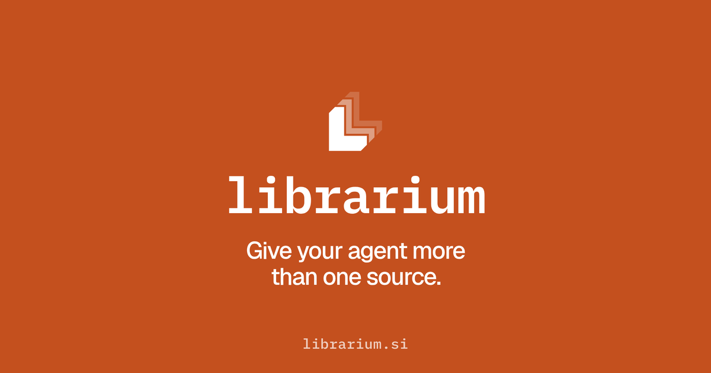

# Laravel AI Librarium

[](https://packagist.org/packages/jkudish/laravel-ai-librarium)
[](https://packagist.org/packages/jkudish/laravel-ai-librarium)
[](composer.json)
[](LICENSE.md)

<p align="center">
  
</p>

Laravel AI Librarium sends one research question to the search APIs, research APIs, and AI answer engines you configure, then stores the answers, citations, and costs as a Run.

It is built on the official [Laravel AI SDK](https://github.com/laravel/ai). Full documentation lives at [librarium.si/docs/php](https://librarium.si/docs/php).

## Requirements

- PHP 8.4 or newer
- Laravel 13.30 or newer
- Laravel AI SDK `^1.0.1`, installed by Composer
- A key for at least one source. The example below uses the Laravel AI SDK's `OPENAI_API_KEY`.

## Install

```bash
composer require jkudish/laravel-ai-librarium
php artisan vendor:publish --tag=librarium-config
```

Credentials come from `config/ai.php` and `config/services.php`. A per-source `key` override belongs in `config/librarium.php`, never in request options.

## First research Run

Add `OPENAI_API_KEY` to `.env`, then preview and run one source:

```php
use Jkudish\LaravelAiLibrarium\Facades\Librarium;

$question = 'Which PHP version does Laravel 13 require?';

$plan = Librarium::research($question)->only(['openai'])->dryRun();
$plan->status(); // "planned"

$run = Librarium::research($question)->only(['openai'])->run();
$run->status();                   // "done"
$run->result('openai')['answer']; // The answer text
$run->citations();                // [['url' => 'https://...', 'title' => '...'], ...]
$run->id();                       // "run_01..."
```

`dryRun()` makes no provider call and stores nothing. `run()` saves the Run, makes one paid OpenAI web-search request, and waits up to `librarium.timeout` (6900 seconds by default). Runs are saved encrypted under `librarium/` on your default filesystem disk, which must be a local disk. Read one later with `Librarium::find($id)`.

A Run's status is `done` when every source succeeded, `partial` when some failed, `failed` when none succeeded, or `running` when a durable task outlives the wait.

## What it does

- Selects sources with `only()`, `skip()`, and saved groups. The shared catalog has 16 research sources and 5 AI answer engines, such as `chatgpt` and `google-ai-overview`.
- Uses `deep()` to choose research-report variants for Exa, Gemini, OpenAI, Parallel, Perplexity, Valyu, and You.com.
- Previews selection and price hints offline with `dryRun()` and `Librarium::sources()`.
- Admits sources under a USD cap with `maxCost()`.
- Queues research with `queue()` and resumes durable provider tasks with `Librarium::find($id)?->refresh()`.
- Stores Runs on a local disk, in a database table, in a cache, in memory, or in your own `RunStore`.
- Uses the same `librarium.run/1` Run JSON as the [Librarium JavaScript CLI and library](https://github.com/jkudish/librarium).
- Adds `librarium:research`, `librarium:show`, `librarium:sources`, and `librarium:prune` Artisan commands, plus a `Tools\RunEvidence` tool for Laravel AI SDK agents.
- Fakes research in tests with `Librarium::fake()`.

## Limits

- `maxCost()` is an admission cap, not a provider-enforced ceiling. Accepted calls can finish and bill above it. Sources without a bounded estimate are skipped as `unpriced` under a cap. A cost the provider did not report stays `null`, never zero.
- Librarium never resubmits paid work or falls back to another source automatically. Inline work cannot resume after the process dies. Durable tasks with a saved handle can.
- Built-in file storage supports local Laravel disks only. Built-in cache storage supports process-local ArrayStore or standalone Redis 7+. Other backends need a custom `RunStore`.
- The database store's migration is optional and never runs automatically.
- AI answer engines need a collector: SearchAPI, DataForSEO, or the separate [Firecrawl adapter](https://github.com/jkudish/laravel-ai-librarium-firecrawl). Engine results are observations of a consumer AI product (`observation: surface`), not API answers.
- Provider text and URLs are untrusted. Escape rendered content and verify consequential claims. Agreement between sources is not independent confirmation.
- Your application owns queue workers, authorization, retention, and evidence policy.

## Learn more

- [Laravel guide](https://librarium.si/docs/php): [library API](https://librarium.si/docs/php/library), [configuration and storage](https://librarium.si/docs/php/configuration), [Artisan commands](https://librarium.si/docs/php/commands), [costs and limits](https://librarium.si/docs/php/costs-and-limits), and [testing](https://librarium.si/docs/php/testing)
- [Sources and options](docs/sources-and-options.md), including Anthropic prompt caching
- [Budget and cost](docs/budget-and-cost.md)
- [Runs, storage, and recovery](docs/runs-storage-recovery.md)
- [Writing a source driver](docs/writing-a-driver.md) and [writing a RunStore](docs/writing-a-run-store.md)
- [Librarium spec](https://github.com/jkudish/librarium-spec): the shared source catalog, Run schemas, and fixtures
- [Changelog](CHANGELOG.md)

Report bugs and ask questions in [GitHub issues](https://github.com/jkudish/laravel-ai-librarium/issues).

## The Librarium family

- [Librarium](https://github.com/jkudish/librarium): the JavaScript CLI, MCP server and library (`npm install -g librarium`).
- [Laravel AI Librarium: Firecrawl](https://github.com/jkudish/laravel-ai-librarium-firecrawl): collects AI answer engine results for the Laravel package through Firecrawl browser sessions.
- [librarium-spec](https://github.com/jkudish/librarium-spec): the shared Run schemas, source catalog and conformance fixtures.
- [librarium.si](https://librarium.si): documentation for all of them.

## Sponsoring

If you find Laravel AI Librarium useful, consider becoming a [sponsor](https://github.com/sponsors/jkudish) or [donating](https://stripe.com/@jkudish).

## Contributing and security

See [CONTRIBUTING.md](CONTRIBUTING.md) to work on the code. To report a vulnerability, see [SECURITY.md](SECURITY.md).

## License

[MIT](LICENSE.md)
